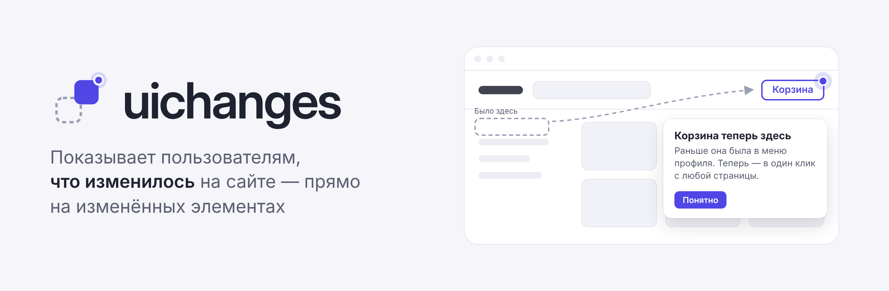
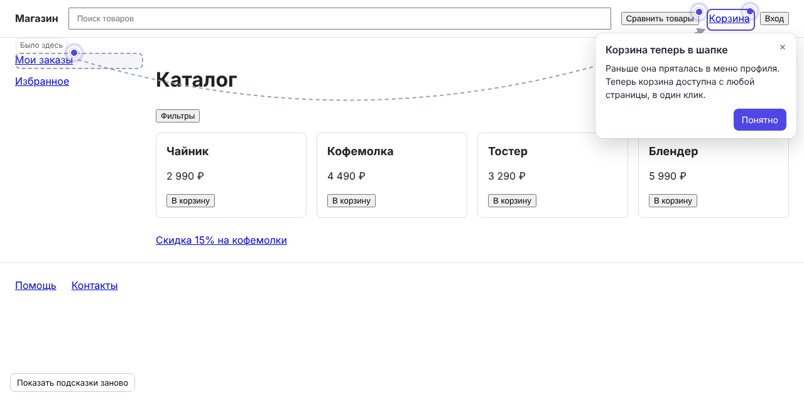
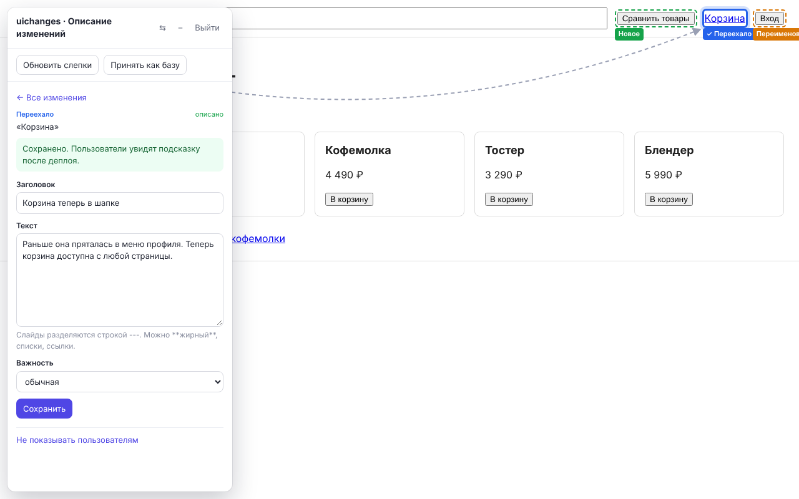

<picture>
  <source media="(prefers-color-scheme: dark)" srcset="docs/images/banner.png">
  
</picture>

<p align="center">
  <a href="https://www.npmjs.com/package/uichanges"></a>
  <a href="https://github.com/uichanges/uichanges/actions/workflows/ci.yml"></a>
</p>

Вы выпустили новую версию: перенесли кнопку, добавили функцию, переименовали раздел. Вы об этом знаете. Пользователь — нет. Он заходит, не находит привычную кнопку и пишет в поддержку, а новую функцию просто не замечает.

uichanges сам находит, что поменялось в интерфейсе, а вы пишете пару предложений об этом. Пользователь при следующем визите видит подсказку на нужном элементе: «Корзина теперь здесь», со стрелкой от того места, где она была раньше.



## Как это работает

1. **uichanges запоминает, как выглядел сайт.** Он открывает ваши страницы в браузере и сохраняет, какие на них кнопки, ссылки и заголовки и где они стоят. Исходный код не важен: годится любой сайт, на React, Vue, Blazor или обычном HTML.
2. **Вы меняете интерфейс, uichanges сравнивает.** Он понимает, что кнопка та же, но переехала, и не путает это с «одну удалили, другую добавили». Изменения, которые не нужно показывать, можно скрыть одним кликом.
3. **Вы описываете изменения прямо на сайте.** Изменённые элементы подсвечены, сбоку панель: заголовок, пара предложений, «Сохранить». Описания хранятся в репозитории рядом с кодом.
4. **Пользователи видят подсказки.** На изменённом элементе появляется точка, по клику — короткое объяснение. Каждый видит подсказку один раз, а новые пользователи не видят ничего: для них всё и так новое.



## Быстрый старт

Нужен Node.js 20 или новее, только на вашей машине: сайту он не нужен.

**1. Установите инструмент** (один раз):

```bash
npm i -g uichanges playwright
npx playwright install chromium
```

**2. Подключите к проекту.** В папке проекта выполните:

```bash
uichanges init
```

Появится папка `.uichanges`. В файле `.uichanges/config.json` укажите адреса страниц и папку, откуда сайт отдаёт статические файлы:

```json
{
  "screens": [{ "name": "home", "url": "http://localhost:5080/" }],
  "manifest": "wwwroot/uichanges.json"
}
```

**3. Добавьте на сайт одну строку** перед `</body>`:

```html
<script src="https://unpkg.com/uichanges/dist/uichanges.js" data-manifest="/uichanges.json" defer></script>
```

**4. Запомните текущую версию сайта.** Запустите сайт и выполните:

```bash
uichanges capture
```

Закоммитьте папку `.uichanges`: это точка отсчёта.

**5. Меняйте интерфейс и описывайте изменения.** Когда что-то поменяли, запустите:

```bash
uichanges review
```

и откройте ссылку, которую он напечатает. Нажмите «Обновить слепки», и все изменения подсветятся на странице. Выберите изменение, напишите заголовок и текст, нажмите «Сохранить». Когда всё описано, нажмите «Принять как базу», закоммитьте и выкладывайте.

Посмотреть, как это выглядит, можно без своего проекта:

```bash
git clone https://github.com/uichanges/uichanges && cd uichanges
npm install && npm run demo
```

## Если uichanges ошибается

- **Текст меняется сам** (выбранная группа, имя, счётчик), и uichanges считает это переименованием. Нажмите в панели «Это данные пользователя» или добавьте элементу атрибут `data-uichanges-dynamic`.
- **Часть страницы всегда разная** (рекомендации, реклама). Добавьте ей `data-uichanges-ignore`, и uichanges перестанет на неё смотреть.
- **Кнопку переделали так, что uichanges её не узнаёт.** Дайте ей постоянное имя: `data-uichanges="cart-button"`. Подойдёт и `data-testid`, если он уже есть.
- **Страницы доступны только после входа.** Один раз войдите в окне, которое откроет `npx playwright codegen --save-storage=auth.json <адрес сайта>`, и укажите `"storageState": "auth.json"` в конфиге. Этот файл не коммитьте.

## Что дальше

Сейчас uichanges умеет находить изменения, описывать их прямо на сайте и показывать подсказки. В планах: картинки «до/после» в подсказках без ручных скриншотов, панель «Что нового» со всеми изменениями сразу и пошаговые обучающие туры.

Все команды, настройки и API — в [справочнике](docs/reference.md).

## Лицензия

MIT
